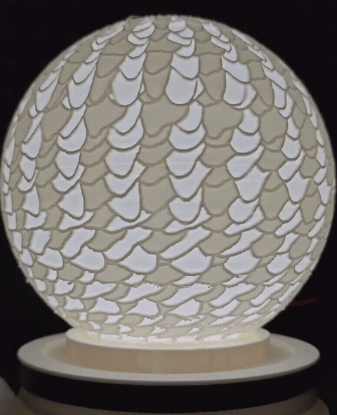
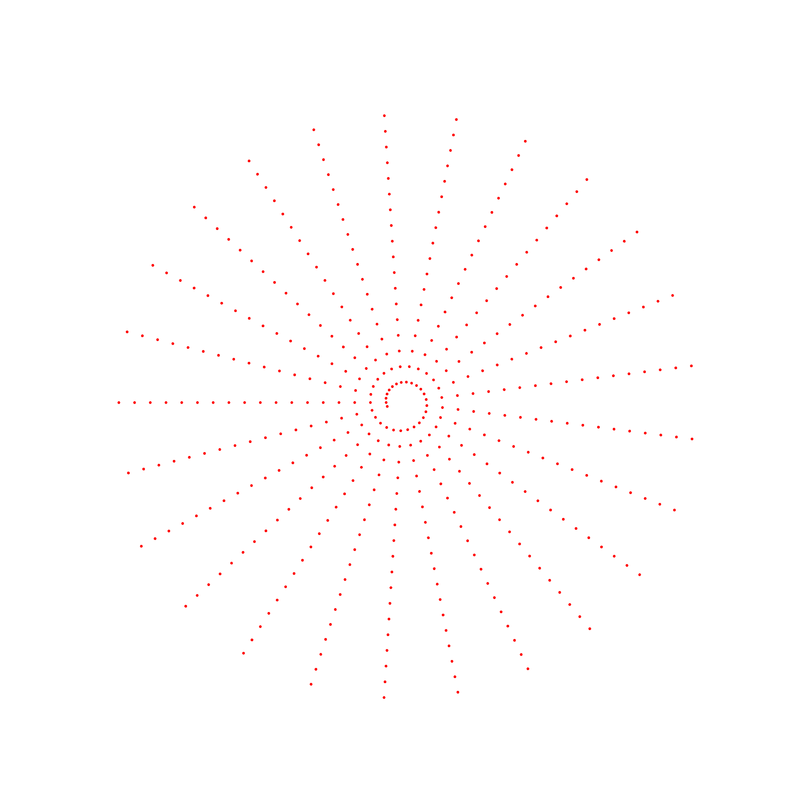
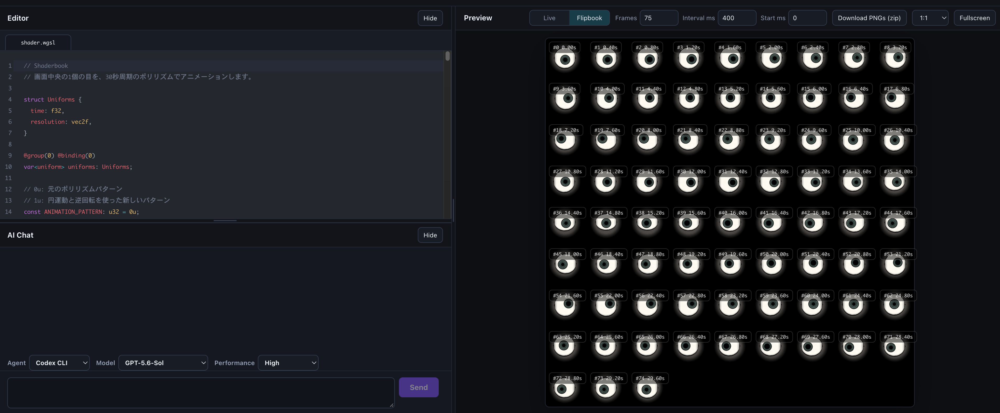
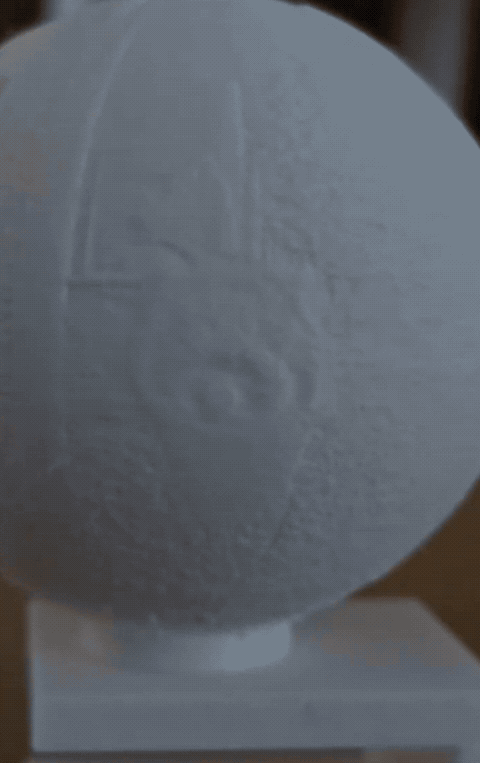
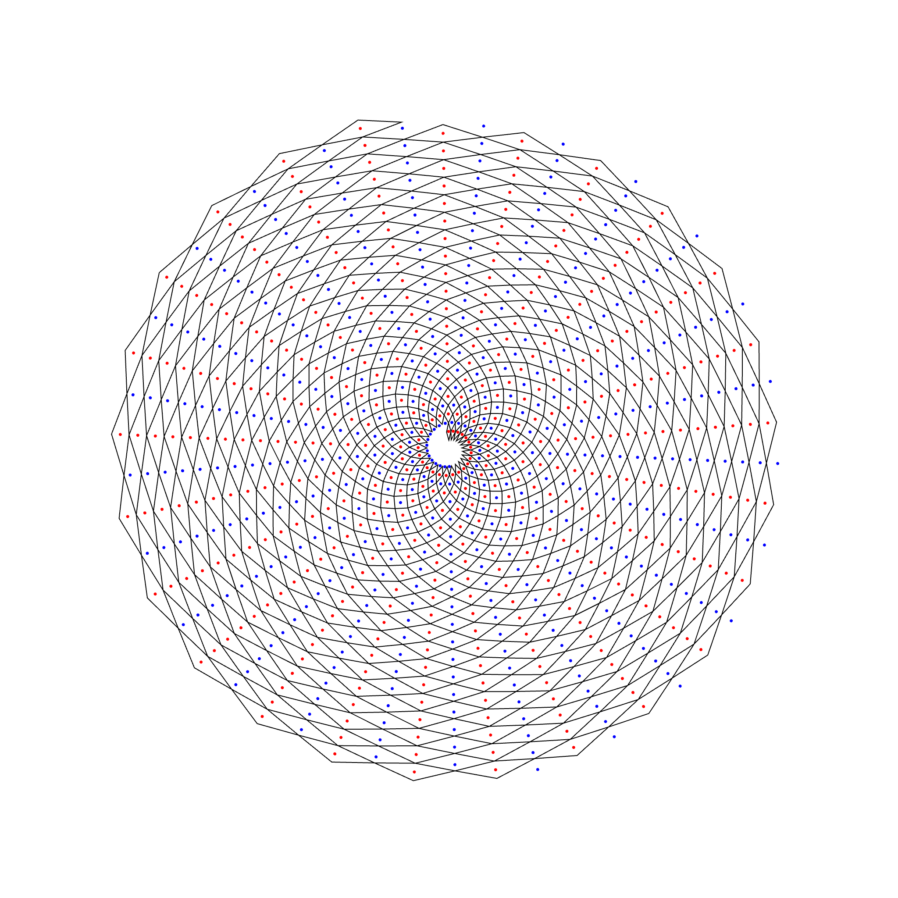
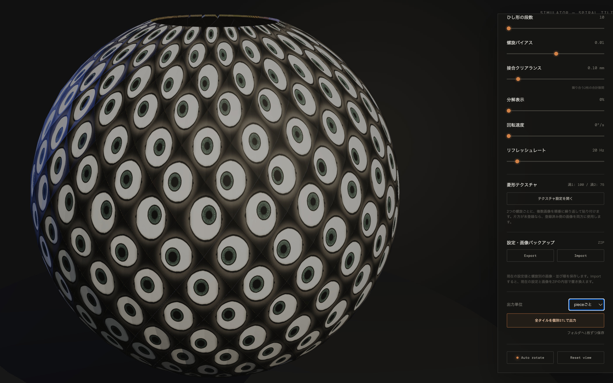
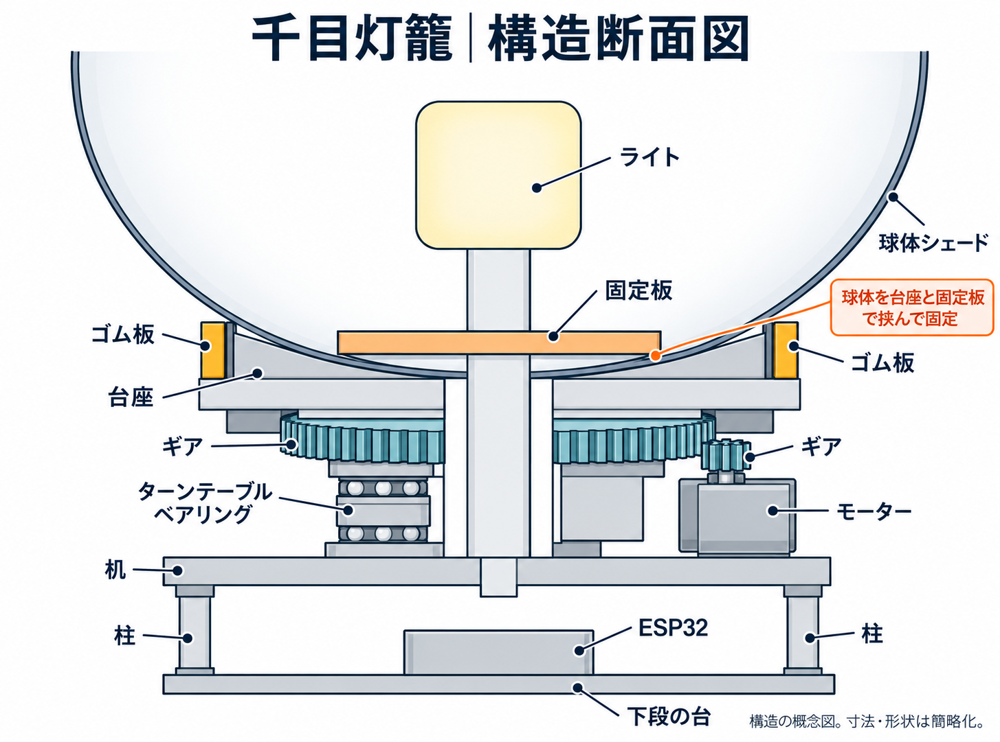
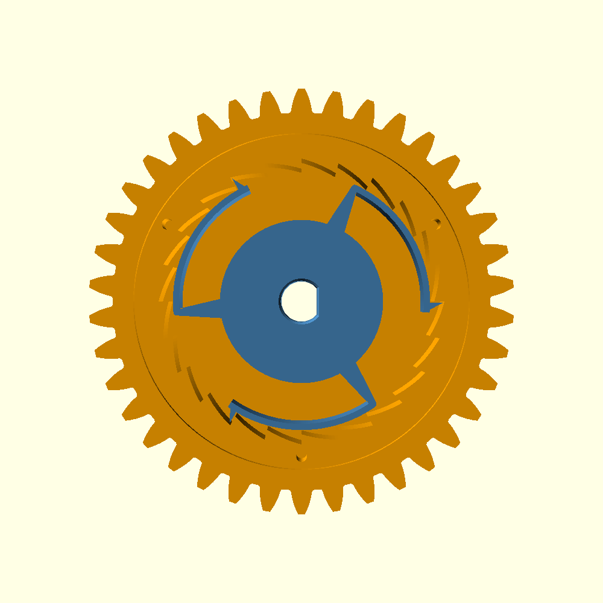
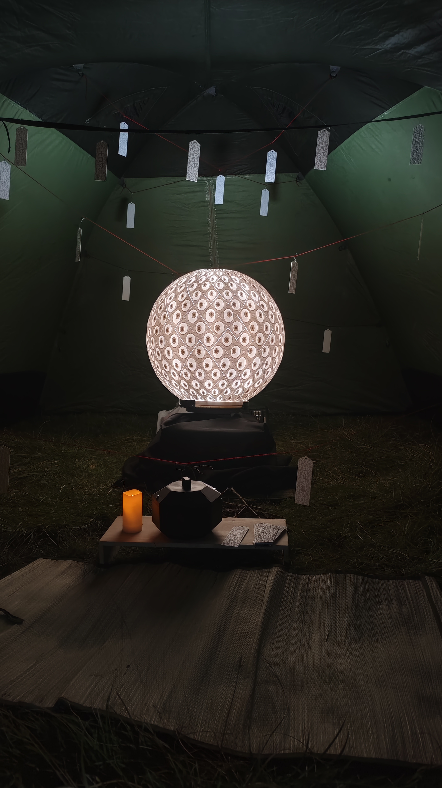
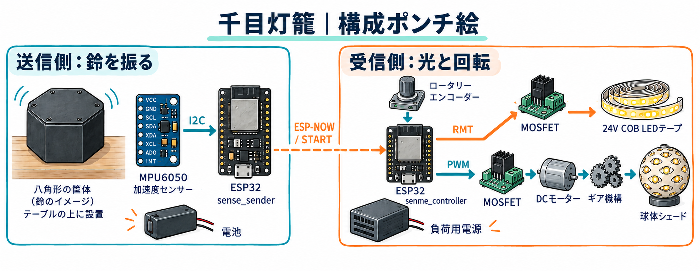

# Zoetlamp「千目灯籠」を作った話

2026年のBurning Japanに「千目灯籠」という作品を持っていった。鈴を鳴らすと、直径60cmの球体に並んだ482個の目玉が動き始める。球体の重さは約7kg。

この1年ほど作ってきたZoetlampを、屋外で展示するならと思い切って大きくしてみた。目玉の動きを考え、3Dプリントしたパーツを溶接し、回す仕組みを作って会場へ持ち込むまでを振り返ってみる。

## Zoetlampとは

「Zoetlamp」は、ゾートロープ（zoetrope）とランプ（lamp）を合わせた名前。ランプシェードを回しながら光を点滅させると、表面に並べた模様が動いて見える。

これまでは直径18cmくらいのシェードに抽象的な模様を付けていた。今回はBurning Japanのテーマに合わせて、具体的なモチーフを使ってみることにした。

## 「千鬼夜行」に持っていくなら

2026年のテーマは「千鬼夜行 || Senki Yagyo」。僕も投票していたテーマなので、決まったときから何か妖怪っぽい作品を作りたいと思っていた。

モチーフに選んだのは妖怪の「百目」。シェードいっぱいの目玉がうごめいたら、気持ち悪いけど楽しそう。目玉ならアニメーションもシンプルに作れそうなので、初めて大型化する作品としてもよさそうだった。

名前は「千鬼夜行」に合わせて「百目」から「千目」に。和風にしたくて「ランプ」を「灯籠」に変え、「千目灯籠」と名付けた。

せっかく会場に持っていくなら大きくしたい、ということで直径は60cmにした。決め手は部屋のドアで、通せそうなのが50〜65cmくらいだったので、その範囲に収めた。作ったはいいけれど部屋から出せない、という事態は避けたい。

## 目玉の配置と動きを考える

いきなり球体の上で考えるのは難しいので、これまでのZoetlampと同じく平面で動きを試すところから始めた。平面ならp5.jsやWebGLで試しやすい。最初から3次元で考えられたら、また違うものが作れるのかもしれない。

今回は目玉を渦巻き状に並べ、外側へ一定の速さで動かすことにした。単純に並べると余白が多くなるので、螺旋を二重にして目玉を増やした。

| 赤い点で示した配置 | 赤と青の点を重ねた配置 |
| --- | --- |
|  |  |

左がひとつの螺旋、右が二重にしたもの。最終的に目玉は482個になった。

目玉のアニメーションには、WGSLの勉強も兼ねて作っていたWebアプリ「shaderbook」を使った。パラパラ漫画モードを追加して、目の向きやまばたきの変化をコマごとに確認できるようにした。

## リソファンで絵を浮かび上がらせる

Zoetlampの模様は、画像の濃淡をプラスチックの厚みに置き換える「リソファン」という技法で作っている。目玉の形をひとつずつモデリングするのではなく、絵から厚みのある形状を作る。

明るく見せたい部分は薄く、暗く見せたい部分は厚く印刷する。裏から光を当てると、その透け方の違いで絵が浮かび上がる。

こちらは茶臼山動物園のレッサーパンダ、ミロ君。目玉の絵も、これと同じように厚みに変えて3Dプリントする。

## 分割して印刷するためのアプリ

これまでのサイズなら、20時間くらいかかるものの、シェードを丸ごと一度で印刷できた。直径60cmではそうもいかないので、分割して出力する必要がある。

ただ、目玉の途中に継ぎ目が入ると、絵がずれてアニメーションの見え方が崩れるかもしれない。そこで目玉の周りに四角い枠を付け、枠のところで分けられるようにした。

この配置を球面に載せ、リソファンにして印刷データを出力するアプリも作った。処理の流れは次のとおり。

1. 球面を、渦巻きに沿って並ぶ四角い領域に分ける。
2. それぞれに目玉のテクスチャを貼り付ける。
3. 絵の濃淡を厚みに変えて、リソファンにする。
4. 3Dプリント用のSTLファイルとして出力する。

画面で形を確認しながら調整して、そのまま印刷データを出せるようにした。

## 86ピースをつなぐ

フィラメントには、PLAよりもしなりがあるPETGを選んだ。3Dプリンターに収まるよう、目玉をだいたい6個ずつまとめて、球体を全部で86ピースに分けた。それぞれ印刷して、ひとつずつ溶接でつないでいった。

基本は摩擦溶接で、隙間を埋めるところや補強したいところには、はんだごてによる溶接も使った。印刷から溶接まで、合わせておよそ1か月かかった。フィラメントを8個使い、完成した球体は約7kgになった。

## 球体を支えて回す仕組み

球体の製作と並行して、回転機構も考えていた。全体の構造は下の図のとおり。

球体の下部を、外側の台座と内側の固定板で挟んで固定する。台座の下にはギアとターンテーブルベアリングを置き、横のモーターから力を伝えて回す。ライトは球体の中央に、制御用のESP32は机の下段に置いた。

図は手描きの断面図を清書したもので、寸法や部品の形は簡略化している。

ベアリングは直径21cmくらいのものを使い、中央には照明の光を通す穴を空けておく。

以前プーリーベルトを使ったときは、モーターの位置を少し変えるだけでベルトが外れやすくなるなど、調整がシビアだった。今回はメンテナンスのしやすさも考えて、ギア同士を直接かみ合わせる方式にした。大きい方のギアは直径22cmくらいを想定し、モーターの回転数から歯数やギア比を考えた。

シミュレーションでは、リフレッシュレート17Hz、回転数43rpmで、狙ったアニメーションが見えることを確認した。

## 急停止で壊れないように

完成が近づいた頃、電源が突然落ちたときのことが気になり始めた。選んだ高トルクのモーターは、外から回そうとしても簡単には回らない。逆駆動しにくいタイプだった。

モーターが急停止しても、球体は慣性で回り続けようとする。その力が固定部にかかると、最悪の場合、つないだパーツがばらばらになるかもしれない。1か月かけてつないだ球体なので、それは困る。

そこでワンウェイクラッチを自作した。モーターからは力を伝えつつ、球体が惰性で回るときには空転できる仕組みだ。

## 台座と電子制御

台座は40×60cmくらいの木の板とVP20の塩ビパイプを組み合わせる構造にして、内側にはモーターや電子回路を置く棚も作った。パイプの固定部品などはOpenSCADで設計して3Dプリントした。

照明は24VのCOBタイプのLEDテープで、MOSFETを使って点滅や明るさを制御する。全体の制御にはESP32を使った。

回転速度と光の点滅周期でアニメーションの見え方が変わるので、現地でも調整できるようにロータリーエンコーダーを付けた。

## 鈴を鳴らして目覚めさせる

起動装置は、神社の鈴緒を引くような仕組みを考えていた。ただ、嬬恋の風など現地の環境に合わせてセンサーを調整するのが難しく、この方法はあきらめた。

最終的には、テーブルに置いた黒い八角形の箱を振って鈴を鳴らすと、作品が動き始める形に落ち着いた。箱の送信機から本体へ、ESP-NOWで起動の合図を送っている。鈴で千目灯籠を「目覚めさせる」という演出にして、操作も作品の雰囲気に合わせた。

## 雨風はテントで、酔っ払いは結界で

Burning Japanは屋外なので、雨風への対策も必要になる。大きな傘や透明なドーム、PVCパイプで組むティピー型やAフレーム型のシェルターなどを考えたけれど、建造物まで作る時間はないし、だんだん考えるのも面倒になってきた。

結局、手持ちのLOGOSのツールームテントを使うことにした。インナーテントを外して作品を置き、手前には座って眺められるようにゴザを敷いた。

もうひとつ気になっていたのが、本体を触られること。表面が汚れるとアニメーションの見え方が崩れるかもしれないので、できれば少し離れて見てほしい。というか、メイカー系のイベントと違って酔っ払いも多い。

そこで、余ったフィラメントでお札を作って結界を張った。妖怪らしい雰囲気を作りつつ、近づきすぎないための境界にもする。わりと実用的な結界だ。

## 会場の奥で見つけてもらう

僕はBurning Manで、Deep Playaに置かれたアートを探して歩くのが好きだ。街の中心から離れたところで「こんなところに、こんなものが？」と出会う、あの感じが楽しかった。

今回も、そんなふうに見つけてもらいたかった。周囲が明るいとアニメーションが見えにくくなることもあり、フリーキャンプエリアの奥の方に設置することにした。

## 5日間の展示

10月7日に会場へ向かい、翌8日に設置を終えた。

配線が回転部分に引っかかって断線するなど、細かいトラブルはあったけれど、夜間だけとはいえ5日間回しきれた。
毎晩でっかい蛾が数匹住み着いていたけれど、アニメーションに影響がなかったのはよかった。

## 感想

企画から約3か月で、ここまで作って会場で動かせたのはうれしい。この1年Zoetlampを作ってきた経験もあるけれど、AIで実装とテストを速く回せたのがでかかった。

シミュレータやSTL化のコードは99％読んでいないし、99.9％はAIが書いたものだ。配置のアルゴリズムや方針は細かく話し合ったけれど、実装とテストはAI任せだった。1年前ならシミュレータを作るだけで精いっぱいだったと思う。今回は実物を作って、展示までできた。作れるものが増えるのはうれしいけれど、たった半年でここまで変わるのは、やっぱり恐ろしい。

「もっと目立つ場所なら、たくさん見てもらえるのに」とは何度も言われた。そう思ってもらえたなら、作った甲斐がある。見られた数だけで成功を決めなくてもいいだろう。

一番印象に残ったのは、子どもたちの反応だった。クジラの中で遊んでいた子たちに「あの遠くで光ってるやつ、見た？」と聞いたら、「見た見た、気持ち悪かった！ 夢に出そう！」と返ってきた。何か光っているのが気になって、見に行ったそうだ。そうやって見つけてほしかったし、この作品には「気持ち悪かった！」もうれしい言葉だった。気になったら、すぐ見に行く。あの好奇心とフットワークは見習いたい。

---

## Appendix：技術スタック

シミュレータやデータ作成用のツールは、すべて自作。CADデータはOpenSCADでコードを書いて作るか、自作ツールからエクスポートした。道具から作ったと言っても、99％はCodexとClaudeが作ったんだけどね。残り1％には、まだ人間が介在する余地がある！

### 構成ポンチ絵

黒い八角形の箱を振ると、MPU6050で検知した揺れをきっかけに送信側ESP32が`START`を送る。受信側ESP32はESP-NOWモードで待機しているときに指令を受け付け、照明とモーターを動かす。ロータリーエンコーダーはモード切替と設定に使う。

部品のつながりを説明する概念図で、外観・配線・寸法は簡略化している。imagegenで生成し、[生成プロンプト](images/senme-system-overview.prompt.txt)も保存している。

### シミュレータとCADデータ

| 対象 | 技術・形式 | 何に使うか |
| --- | --- | --- |
| 自作の球体シミュレータ | TypeScript、Three.js、Vite、HTML/CSS | 球体リソファンの3Dプレビュー、形状調整、STL出力。ブラウザ上で動くWebアプリ |
| シミュレータの開発環境 | Node.js 22.12以上、npm | 開発サーバー、ビルド、テスト。依存関係は[package.json](../simulator/package.json)に記録 |
| 機構部品のCAD | OpenSCAD、BOSL2 | ギア、支持部品、固定具、配線ボックス、八角形の筐体をコードで設計 |
| 設計・造形データ | SCAD、STL、SVG | SCADは寸法を変更できる設計ソース、STLは3Dプリント用のメッシュ、SVGはお札などの2D図形 |
| ギアの動作確認 | OpenSCADのアニメーション | 歯数比から回転角を計算して、かみ合いの様子を表示 |
| 球体の造形材料 | PETG | 本記録の球体は86ピースを印刷し、摩擦溶接とはんだごてで接合 |

ここでいう「シミュレータ」は、球体の形を確認して印刷データを作るためのアプリ。ギアのアニメーションも含め、荷重・摩擦・変形を解く物理解析ではない。起動方法は[simulator/README.md](../simulator/README.md)にまとめている。

### 電子パーツと制御

| 部品・技術 | 用途・仕様 |
| --- | --- |
| ESP32-WROOM系開発ボード | 揺れ検知送信側とLED・モーター制御側に各1台。ファームウェア資料にはELEGOO ESP-32（USB-C／CP2102）の記載あり |
| MPU6050 | 加速度を使った揺れ検知。ESP32とはI2Cで接続 |
| 押しボタン付きロータリーエンコーダー | モード切替、回転速度・光の点滅周期などの調整。型番は未記録 |
| 24V COBタイプのLEDテープ | 球体内部の照明。記録上のLED回路は24V・48W。商品型番は未記録 |
| ブラシ付きDCモーター | ギア機構を通じて球体を回転。商品型番・定格は未記録 |
| NチャネルMOSFET | LEDとモーターをそれぞれ駆動。型番は未記録 |
| 電池・負荷用電源 | 送信機とLED・モーターへの給電。電源の型番・電池容量は未記録 |
| ESP-NOW | ESP32間の開始指令の無線通信。ルーターへの接続は不要 |
| RMT／LEDC | ESP32の周辺機能。RMTでLED波形、LEDCでモーターPWMを生成 |
| Preferences／NVS | 設定値をESP32内蔵フラッシュに保存 |

配線や書き込みの手順は、[コントローラー](../firmware/README.md)と[揺れ検知送信機](../firmware/sense_sender/README.md)の資料にまとめている。ファームウェアの資料は汎用のLEDを想定しているが、この記録では実際に使った24V COB LEDテープについて説明している。

### 開発言語

| 言語 | 担当 |
| --- | --- |
| TypeScript、HTML/CSS | 球体シミュレータの形状処理・画面 |
| C++ | ESP32のArduinoスケッチと制御ロジックのテスト |
| OpenSCAD言語 | 機構部品のパラメトリック設計 |
| Bash | Arduino CLIによるビルド・書き込みの自動化 |
| WGSL | 初期の目玉表現を検討した別プロジェクト「shaderbook」で使用。本リポジトリの球体シミュレータとは別 |

ESP32の開発にはArduino-ESP32 3.3.8とArduino CLIを使った。シミュレータにはNode.jsのテスト、TypeScriptの型チェック、ESLintを、ファームウェアにはPC上で動かすC++のロジックテストを用意している。
